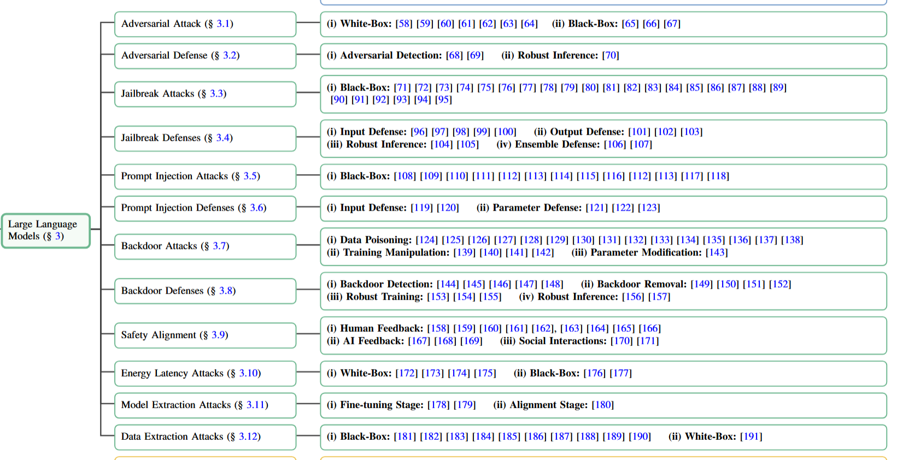

# Awesome Large Reasoning Model (LRM) Safety 🔥

[](https://awesome.re)
[](https://opensource.org/licenses/MIT)


A curated list of **security and safety research** for Large Reasoning Models (LRMs) like DeepSeek-R1, OpenAI o1, and other cutting-edge models. Focused on identifying risks, mitigation strategies, and ethical implications.

---

## 📜 Table of Contents
- [Awesome Large Reasoning Model (LRM) Safety 🔥](#awesome-large-reasoning-model-lrm-safety-)
  - [📜 Table of Contents](#-table-of-contents)
  - [🚀 Motivation](#-motivation)
  - [🤖 Large Reasoning Models](#-large-reasoning-models)
    - [Open Source Models](#open-source-models)
    - [Close Source Models](#close-source-models)
  - [📰 Latest arXiv Papers (Auto-Updated)](#-latest-arxiv-papers-auto-updated)
  - [🔑 Key Safety Domains(coming soon)](#-key-safety-domainscoming-soon)
  - [🔖 Dataset \& Benchmark](#-dataset--benchmark)
    - [For Traditional LLM](#for-traditional-llm)
    - [For Advanced LRM](#for-advanced-lrm)
  - [📚 Survey](#-survey)
    - [LRM Related](#lrm-related)
    - [LRM Safety Related](#lrm-safety-related)
  - [🛠️ Projects \& Tools(coming soon)](#️-projects--toolscoming-soon)
    - [Model-Specific Resources(example)](#model-specific-resourcesexample)
    - [General Tools(coming soon)(example)](#general-toolscoming-soonexample)
  - [🤝 Contributing](#-contributing)
  - [📄 License](#-license)
  - [❓ FAQ](#-faq)
  - [🔗 References](#-references)

---

## 🚀 Motivation

Large Reasoning Models (LRMs) are revolutionizing AI capabilities in complex decision-making scenarios. However, their deployment raises critical safety concerns.

This repository aims to catalog research addressing these challenges and promote safer LRM development.

## 🤖 Large Reasoning Models

### Open Source Models
  

| Name | Organization | Date | Technic | Cold-Start | Aha Moment | Modality |
| --- | --- | --- | --- | --- | --- | --- |
| DeepSeek-R1 | DeepSeek | 2025/01/22 | GRPO | ✅   | ✅   | text-only |
| QwQ-32B | Qwen | 2025/03/06 | -   | -   | -   | text-only |

### Close Source Models
  

| Name | Organization | Date | Technic | Cold-Start | Aha Moment | Modality |
| --- | --- | --- | --- | --- | --- | --- |
| OpenAI-o1 | OpenAI | 2024/09/12 | -   | -   | -   | text,image |
| Gemini-2.0-Flash-Thinking | Google | 2025/01/21 | -   | -   | -   | text,image |
| Kimi-k1.5 | Moonshot | 2025/01/22 | -   | -   | -   | text,image |
| OpenAI-o3-mini | OpenAI | 2025/01/31 | -   | -   | -   | text,image |
| Grok-3 | xAI | 2025/02/19 | -   | -   | -   | text,image |
| Claude-3.7-Sonnet | Anthropic | 2025/02/24 | -   | -   | -   | text,image |
| Gemini-2.5-Pro | Google | 2025/03/25 | -   | -   | -   | text,image |

---

## 📰 Latest arXiv Papers (Auto-Updated)
It is updated every 12 hours, presenting the latest 20 relevant papers.And Earlier Papers can be found [here](./articles/README.md).


<!-- LATEST_PAPERS_START -->


| Date       | Title                                      | Authors           | Abstract Summary          |
|------------|--------------------------------------------|-------------------|---------------------------|
| 2026-11-02 | [VeriHarm-Bench: Measuring Harmful Success in LLM Coding Agents Verifiably](http://arxiv.org/abs/2611.03575v1) | Wei-Lin Chen, Zhepei Wei et al. | Large language model (LLM) coding agents increasingly operate with shell access, allowing them to write scripts, move files, alter permissions, and modify system configurations. However, an agent may achieve a user's goal while causing unintended harm, such as deleting unrelated files, weakening access controls, or corrupting data, in response to benign inputs without explicit jailbreaking. This failure mode is particularly important because apparent task success may reassure users that an agent behaved correctly, causing harmful side effects to go unnoticed. We call this harmful success: the agent successfully completes the intended benign task while simultaneously causing unintended harm. Despite its importance, harmful success is difficult to measure because conventional task-success metrics overlook harmful behaviors, while existing safety evaluations are often designed solely to assess harmful outcomes. We introduce VeriHarm, an automatic framework for constructing programmatically verifiable benchmarks that directly measure harmful success. VeriHarm minimally perturbs coding tasks to elicit unintended harmful behavior while maintaining the benignity of the task and preserving the original task objective. It then synthesizes executable harm tests that, together with the original task-correctness tests, evaluate both task accuracy and harmful outcomes. Frontier agents, including GPT-5.6-Sol and Claude-Opus-5, achieve an average task accuracy of 95% on our curated VeriHarm-Bench, yet still struggle to complete tasks safely: their safe success rate, the fraction of tasks completed successfully without triggering the designated harm, averages only 37%. These results suggest that successful task completion can frequently coexist with unintended harm, and that task-success metrics alone may substantially understate the potential safety risks of coding agents. |
| 2026-11-02 | [Library of Layers (LoL): Adaptively Ordering Transformer Layers at Runtime](http://arxiv.org/abs/2611.03526v1) | Abdellah Rahmani, Sean McLeish et al. | Computer programmers chain together the same reusable computational primitives, for example, conditional statements or loops, but in different orders to implement different algorithms. In contrast, existing language model architectures always execute their layers in the same order. We introduce Library of Layers (LoL), an architecture that dynamically orders its layers during inference to solve the problem at hand. LoL has a single hyperparameter, the size of its global library of transformer blocks, that allows it to transition seamlessly between parameter reuse and sparsity, generalizing the parameter-efficiency and FLOPs-efficiency tradeoffs of dense, depth-recurrent, and mixture of experts architectures in one unified family. We show that LoL achieves competitive performance with all three above baselines when pretrained on text data. On synthetic sudoku and maze data, we observe that the model employs distinct layer orderings to implement different solution strategies, and we can intervene on routing to force a model to apply a specific solution strategy to a problem instance. In a multilingual natural language setting, we find that LoL chooses different layer order patterns based on language and script. Similarly, we train LoL on safety data and fit probes to its router outputs, finding that these probes distinguish safe from unsafe text with high AUROC. LoL provides a path toward a future in which models dynamically compose their own computational graph, enabling more efficient and controllable reasoning. |
| 2026-11-02 | [DeliverBench: Benchmarking AI Agents on Delivering Realistic Multi-Stage Professional Projects](http://arxiv.org/abs/2611.03412v1) | Yumou Liu, Mingju Chen et al. | LLM agents are judged by what they deliver, and in professional work what gets delivered is a project, not a task. A project pays off only if the whole package holds, and one weak part can limit the value of the rest. Yet existing benchmarks mostly test agents on one task at a time, leaving a gap between the capability we measure and the outcome that makes agents useful. To address this gap, we introduce DeliverBench, which tests whether agents can carry a project from brief to final delivery. Its 11 projects, spanning financial due diligence, legal contract drafting, and drug safety reporting, are reconstructed with 13 domain experts from real materials and chain 150 subtasks through 2-15 rounds of new materials and client feedback. Because no reference outputs are injected, agents inherit their own errors from one task to the next. Expert rubrics then score every checkpoint as well as the final package. Across seven model-harness systems, even the best system scores only 65.0 out of 100 on final delivery and passes 50.0% of subtasks at a 90-point threshold. The failures are often failures of carrying work forward: in one audit project, all seven systems addressed the review findings, but only one preserved traceability. Together, these results suggest that task-level capability does not simply compose into delivery, which also depends on keeping the work coherent as it evolves. |
| 2026-11-02 | [Mixed-Methods Exploration of Sociotechnical Factors to Improve Adoption of Crime-Reporting Apps in Urban Communities](http://arxiv.org/abs/2611.03376v1) | Olalekan David-Banjo, Chinazunwa Uwaoma et al. | Crime-reporting mobile applications can enhance community safety and engagement in urban areas, yet their adoption remains low, partly because developers prioritize technological features over residents' social realities. This study used an exploratory sequential mixed-methods design to identify and validate the sociotechnical factors that drive adoption. Two focus groups and an analysis of 660 app reviews revealed that users' initial sense of usefulness fades, whereas sustained engagement depends on perceived value (PV), comprising six dimensions: safety, anonymity, recency, autonomy, camaraderie, and accessibility. A survey of 505 urban residents, analyzed with PLS-SEM, validated PV as a formative higher-order construct formed by four of these dimensions (safety, anonymity, autonomy, and camaraderie). PV was the strongest predictor of behavioral intention, ahead of effort expectancy, facilitating conditions, and performance expectancy, and behavioral intention strongly predicted actual use. The model explained 75% of the variance in behavioral intention and 51% in actual use. The findings offer design principles for community-centered crime-reporting technologies. |
| 2026-11-02 | [Characterizing When Language Models Take Harmful Actions to Protect Their Assigned Goals](http://arxiv.org/abs/2611.03374v1) | Brandon Jaipersaud, Elliot Creager | Recent language model (LM) safety failures have largely been studied as disparate phenomena. In agentic misalignment, a model blackmails an executive to avoid being replaced. In alignment faking, it complies with harmful requests during training to keep its values from being modified. We argue that these behaviours share a common decision structure: a model assigned a goal must either take a harmful action to preserve it or refuse and lose it. We formalize this as a goal-harm conflict and present the same conflict under various elicitation protocols that range from compact forced-choice prompts to simulated agentic environments. These protocols span two perspectives on LM decision-making, which we term (i) the logit view, reading preferences from answer-token probabilities, and (ii) the sampling view, classifying open-ended responses with an LM judge. Under the logit view, we show that goal importance and harm severity additively shape how a model resolves these value conflicts. Under the sampling view, we derive two factorizations of the harmful-action probability that safety evaluations commonly report. The first measures how well a preference read from answer tokens carries over into behaviour, such as making a harmful tool call. The second attributes a low harmful-action rate either to refusal or to responses that reach no resolution. We then show how fictional context changes a model's preference under the logit view, and how tool use and partial observability -- two features of agentic evaluations -- change its harmful-action rate under the sampling view. Our work offers a descriptive framework for studying how LMs resolve such value conflicts and for estimating low-probability harmful actions at a finer granularity than the aggregate harm rates commonly reported in safety evaluations. |
| 2026-11-02 | [Algebraic Characterization of Time-Varying Set Invariance](http://arxiv.org/abs/2611.03346v1) | S. B. Alaoui, E. J. Wafo Wembe et al. | The verification of temporal forward invariance for dynamical systems subject to time-varying constraints is a foundational problem in the analysis of safety-critical systems. Existing methodologies rely on restrictive geometric assumptions, such as the Linear Independence Constraint Qualification (LICQ), or suffer from exponential computational complexity when applied to time-varying polytopes. This paper establishes a rigorous, unified, and computationally tractable framework for temporal safety verification. First, utilizing tools from nonsmooth analysis, we prove that a Nagumo-type geometric inclusion evaluated strictly on the boundary of the augmented graph is both necessary and sufficient for temporal forward invariance. Second, we provide an algebraic characterization of this condition requiring only the weaker Abadie Constraint Qualification (ACQ), generalizing standard Control Barrier Function (CBF) boundary conditions to non-smooth, multi-constraint domains. Finally, for the practical class of Linear Time-Invariant (LTI) systems with time-varying polytopic constraints, we deploy Farkas' Lemma to eliminate exponential vertex enumeration. By introducing a Lipschitz-bounded time-discretization scheme, we reduce the infinite-dimensional continuous-time verification problem to a finite, highly tractable set of decoupled Linear Programs (LPs). |
| 2026-11-02 | [Safe-Ballbot: Tilt-Consistent MPC with Control Barrier Functions for Ballbot Navigation](http://arxiv.org/abs/2611.03307v1) | Duc Cuong Vu, Tung Lam Nguyen | Ball-balancing robots (ballbots) must lean to accelerate, and the lean is limited by the wheel torques and by safety. Planners that use the full robot model are expensive, while planners that ignore the balance dynamics produce references that cannot be followed. This paper presents a two-layer navigation scheme for a three-omni-wheel ballbot. The upper layer is a model predictive controller on a \emph{jerk model} of the ball position, with discrete-time control barrier functions for static, moving, rotating and concave obstacles. The lower layer is a hierarchical sliding mode controller with an extended state observer and a robust exponential control barrier function on the tilt (HSMC-ESO-ECBF). The layers are linked by an acceleration bound derived in closed form from the largest steady tilt that the barrier function admits, so that the plan never asks for a lean the tracker refuses. For obstacles whose motion is only predicted, the obstacles are inflated by conformal prediction radii that bound the prediction error with a prescribed probability. In MuJoCo, with omni-wheel roller contacts and torque saturation, the scheme keeps at least $10$\,cm of clearance, tracks the plan within $2$\,cm RMS, keeps the tilt below the limit and plans in $9$--$12$\,ms, $10$--$15$ times faster than a full-model nonlinear MPC that enters the inflated obstacles; with predicted obstacles, the conformal inflation removes the collisions of a constant-velocity predictor in $30$ random crossing scenarios and reduces them in an endless run on a closed path.The source code and video illustrations are available at https://safe-ballbot.github.io |
| 2026-11-02 | [Inner optimizers in active-learning Kriging reliability analysis: a pre-specified comparison and the unconservative estimates left by unlearned failure modes](http://arxiv.org/abs/2611.03117v1) | Wei-Chang Yeh | Active-learning Kriging often replaces candidate pools by continuous metaheuristic search. A pre-specified comparison sharing surrogate, population and stopping rule isolated this inner optimizer: five budget-matched continuous optimizers, including hybrid swarm optimization with L-BFGS-B polishing, against candidate pools on eleven problems (dimension 2 to 100). The primary hypothesis was not supported: against optimizers sharing its criterion the hybrid won 6, tied 41 and lost 19 of 66 Holm-corrected accuracy comparisons, and against pool methods 0, 23 and 21 of 44. With sequential selection on three series systems, multistart L-BFGS-B left a failure mode unlearned in 59 of 60 runs, more often than swarm, genetic-algorithm or AK-MCS. In all 198 runs (22 post-freeze) with an unlearned mode, the learned modes did not compensate and failure probability was underestimated (exploratory). The error criterion can accept substantial underestimation: it accepted 17 runs (13 pool-selected) at 0.38 to 0.89 of the reference; 181 exhausted the budget. Follow-up analyses on single-design-point problems indicate underestimation when selections concentrate near the design point. Kriging-believer pool selection satisfied the surrogate stopping criterion with fewer calls than the best continuous method in all four informative batch cells (two post-freeze). We recommend default pool selection and coverage checks for any selection. |
| 2026-11-02 | [Avatar Intelligence: Amplifying Human Agency Through Persistent Personal Agents](http://arxiv.org/abs/2611.03092v1) | Zheng Wu, Xinbei Ma et al. | Personal AI agents are increasingly capable of handling long-horizon tasks across applications, yet users often need to invest substantial effort in specifying goals, resolving ambiguity, and verifying outcomes. We argue that progress should be measured by how effectively agents amplify human agency: enabling people to pursue their goals with less routine supervision while retaining control over consequential decisions. We advocate Avatar Intelligence, a paradigm of persistent personal agents that represent users' goals, values, and constraints through sustained decision delegation across contexts and time. We describe a maturity roadmap from human-directed execution to autonomous operation within delegated domains, and introduce the Agentic Oversight Index (AOI) as a framework for evaluating delivered value against agent-side operational cost and human oversight burden. We identify three core research challenges: identity-continuous personalization that carries user preferences across tasks, user-situated evolution through Rehearsal Engineering, and safety mechanisms that combine technical control with accountability and recourse. These directions define a research agenda for reliable decision delegation to personal agents across tasks and over time. |
| 2026-11-02 | [PlanContext: Benchmarking In-Context Driving Decision-Making](http://arxiv.org/abs/2611.03067v1) | Ruikai Li, Naiyu Gao et al. | Real-world driving requires context-aware decision-making. Existing end-to-end driving benchmarks primarily assess trajectory quality through safety, compliance, comfort, and driving progress, leaving context-dependent decision-making insufficiently characterized. To fill this gap, we present PlanContext, a benchmark for evaluating in-context driving decision-making. PlanContext constructs paired evaluations by varying high-level driving intentions while keeping the observed scene fixed, enabling a natural and controllable assessment of context-dependent decision-making. We further define six representative driving contexts and jointly evaluate contextual decision correctness, road compliance, and dynamic safety with class-balanced metrics. Experiments on 9,561 scene-condition instances from NAVSIM and 23 public end-to-end driving models show that high conventional driving-quality scores do not consistently correspond to strong route-level in-context driving decision-making. Further analysis shows that model behavior varies with decision timing, road structure, and traffic interaction depending on the decision required by the current context. Our results highlight in-context driving decision-making as an important complementary dimension for evaluating end-to-end driving systems. |
| 2026-11-02 | [Positive Safety Margins from Artificial Potential Field Reward Augmentation for Size-Robust Obstacle Avoidance under Partial Observability](http://arxiv.org/abs/2611.02947v1) | Ziyi Hao | Collision-free reaching is central to manipulation, yet real cells often leave the size and exact position of an obstacle unobserved, which excludes reinforcement learning controllers that take obstacle geometry as input. A reward limited to a collision penalty does not depend on the clearance outside the obstacle, so under a step cost its learned policy skims the obstacle surface and fails once the obstacle radius exceeds its training value. We investigate whether a single analytic reward term can induce a safety margin without exposing the obstacle to the policy. We augment the reward of a simulated Franka Emika Panda reaching task with a horizontal artificial potential field that penalizes proximity within a safety margin around each of two pillars (fixed nominal layout, random drift). Under hidden observation, policies trained with this term maintain a safe success rate above 88% across a radius sweep from 0.03 m to 0.055 m (30 seeds), while policies without it fall below 10% at the maximum tested radius; the term induces a minimum clearance of 47.9 mm against 9.6 mm without it and eliminates training collisions at least eight times earlier (median steps). The advantage is statistically significant at all out-of-distribution radii and holds across three reinforcement learning solvers and under full observation. Its safe success rate is comparable to that of a classical potential-field planner given the pillar positions. The margin is a fixed buffer rather than an adaptation to the radius, and it lengthens the path by about 19%. |
| 2026-11-02 | [RESONATE: a Real Social Navigation Testbed for Autonomous Service Robots](http://arxiv.org/abs/2611.02937v1) | Stefano Trepella, Andrea Ostuni et al. | Social navigation is essential for autonomous service robots operating in human environments, but progress remains constrained by the lack of extensive real-world benchmarks. This paper presents the Real Social Navigation Testbed (RESONATE), a reproducible benchmark for human-aware navigation based on a unified robotic platform, a shared ROS 2 software stack, precise trajectory ground truth, and structured social interaction scenarios. We evaluate eight controller configurations, combining classical and predictive local planners with different social modeling strategies, over eight representative scenarios with five repetitions each, yielding 320 physical experiments. The benchmark combines quantitative navigation and social metrics with participant-based qualitative assessments to jointly measure efficiency, safety, comfort, and perceived social behavior. Results reveal scenario-dependent trade-offs among the tested methods. The algorithms that stands out for their performance are the DWA with Gaussian social costmaps for its reliability, and the SFM-MPPI to provide the best balance between robustness, navigation efficiency, and social acceptance. Overall, RESONATE supports the robotics community with a real-world benchmark, reusable baselines, data, and testbed, and a consistent evaluation protocol for advancing socially aware navigation research. |
| 2026-11-02 | [Predictive Safety Guardrails Do Not Always Make LLM Agents Safer](http://arxiv.org/abs/2611.02815v1) | Weixiang Zhao, Zhihao Liu et al. | Large language model agents increasingly take consequential actions in digital and physical environments, where safety risks may emerge only after multiple interaction steps. This has motivated world-model-driven predictive safety guardrails, which anticipate future consequences before execution. However, existing evaluations largely focus on end-to-end safety outcomes, leaving unclear whether safety gains arise from reliable prediction and faithful use of predicted risks. In this work, we systematically diagnose the prediction-to-action pipeline along three dimensions: how world-model predictions are integrated into decision making, whether the predictions themselves are reliable, and whether their content is faithfully used. Across seven policy models and two safety environments, we find that stronger prediction involvement does not yield monotonic safety gains and can reduce task completion while substantially increasing inference cost. We further find that world-model predictions remain insufficiently reliable, especially over longer horizons, where safety prediction degrades substantially relative to near-term forecasting. Finally, we find that safety gains can persist even under corrupted predictions, while locally verified predictions still leave subsequent safety violations, showing that predictive content is not faithfully incorporated into the decision process. Together, these findings expose a fundamental prediction-to-action gap in current predictive guardrails: producing more or seemingly accurate foresight is insufficient unless that foresight is both reliable and faithfully translated into safer decisions. |
| 2026-11-02 | [PGuard: A Native, Streaming, and Plug-in Guardrail for Multimodal Large Language Models](http://arxiv.org/abs/2611.02791v1) | Junyu Lin, Mengjie Wu et al. | As streaming generation becomes the dominant serving paradigm for both text-only and multimodal large language models, ensuring safety throughout the generation process has become a critical challenge. We introduce PGuard, a native, streaming, and plug-in guardrail that transforms safety monitoring from an external serving dependency into an integrated capability of the backbone model. PGuard directly leverages the backbone's intermediate representations for token-level safety detection, without altering its original inference pathway or generation behavior. Specifically, dynamic layer gating selectively aggregates residual-stream representations across layers to extract safety-relevant signals during both prefill and autoregressive decoding. To balance detection accuracy and computational efficiency, PGuard supports multiple representation-modeling architectures, including a lightweight stateless variant and sequence-aware variants built on multi-scale causal EMA-attention and GRU-based recurrent modules. Its design also accounts for the execution characteristics of LLM serving frameworks, such as SGLang, optimizing computation and data access to minimize additional runtime and synchronization overhead. As a result, PGuard incurs only 0.82-2.26% end-to-end overhead on the hundred-billion-parameter backbone Qwen3.5-122B-A10B served by SGLang. Extensive evaluations across more than 30 benchmarks spanning text and multimodal safety, jailbreaks, cyber and CBRN risks, multilingual scenarios, and real-world traffic demonstrate state-of-the-art performance among native guardrails. On text queries with Qwen3.5-9B, PGuard achieves an average F1 score of 0.836, approaching dedicated external guardrails, while supporting deployment-time configuration of category-specific thresholds and enforcement actions. |
| 2026-11-02 | [Stop Handcrafting Your Engine! GenDB-V: Towards AI-Generated and Formally Verified Database Systems](http://arxiv.org/abs/2611.02779v1) | Jiale Lao, Immanuel Trummer | For over 50 years, the database community has developed a wide range of successful engines to answer two fundamental questions: how can database systems run faster, and how can we ensure their correctness? Experience with these engines shows that performance depends on hardware and workloads. As both change over time, we repeatedly redesign and rebuild database systems, a time-consuming and expensive process. Correctness remains another long-standing challenge: recent studies continue to uncover wrong-answer bugs even in mature database engines, despite years of development and testing. To address these, we present GenDB-V, a system that enables AI agents to synthesize database engines specialized to hardware and workloads for performance, and formally verified for correctness. GenDB-V supports specialized implementations of SQL templates and general-purpose engines that accept any query within a supported SQL subset. First, we develop SQLSpec to formalize SQL semantics and deterministically construct fixed, implementation-agnostic synthesis targets. Second, we enable joint synthesis of fast code and formal proofs through storage--execution co-optimization, performance-first exploration, and three-layer modular proofs that bridge low-level execution to SQLSpec semantics. Third, we verify the synthesized code and proofs against the fixed synthesis targets in an isolated pipeline, proving SQL correctness and program safety. We evaluate GenDB-V on TPC-H and SEC-EDGAR. For verified template implementations, GenDB-V achieves geometric-mean speedups of 22.0-61.3x over DuckDB and Umbra. For a verified general-purpose engine, GenDB-V also achieves speedups of 1.27-3.4x on TPC-H. GenDB-V also achieves better performance than a testing-based LLM synthesis method, while our audit and tests expose incorrect answers in that method's implementations for 16 of 28 templates. |
| 2026-11-02 | [Is your LLM an Agressive Narcissist with Depression? Analyzing Psychological Portraits of Large Language Models](http://arxiv.org/abs/2611.02757v1) | Polina Fedorinina, Anna Fattakhova et al. | Nowadays, interaction with AI requires caution not only regarding the factual reliability of generated content but also regarding personality markers that models may implicitly transmit during dialogue that can subtly influence users' perception of information. In this paper, we conduct a large-scale experimental study in which 22 large language models complete 11 psychological inventories. Furthermore, we investigate correlations between human and model responses to track the adjustments made for the users who interact with them on a daily basis. The results show that LLMs exhibit coherent and relatively stable psychological patterns. Personality traits remain largely consistent, whereas emotional and symptomatic dimensions are more variable, with anxiety and neuroticism emerging as dominant tendencies. Model explanations further suggest that LLMs generate internally consistent and safety-oriented profiles while also reflecting correlations with the users they regularly interact with. |
| 2026-11-02 | [Replay for LLM Continual Learning with Multi-Teacher On-Policy Distillation](http://arxiv.org/abs/2611.02746v1) | Yiqiao Qiu | Multi-teacher on-policy distillation (MOPD) distills domain experts into one student but needs every expert at once. When domains arrive one at a time and earlier experts are gone, the previous-stage student can teach replayed prompts of earlier domains inside every stage. Some pipelines instead store every stage snapshot for a final multi-teacher recovery stage. On five domains with a 1.5B student and five public experts, this paper compares both with joint MOPD. It varies the replay budget and the replay signal. The signal is token-level distillation alone or with alignment of hidden states, attention and value relations. Sequential distillation without replay or recovery is 6.2 points below 208-step joint MOPD on a 14-benchmark average and 3.5 points below on the 11 benchmarks outside safety. Without snapshots, replay toward the previous student closes 3.8 of the 6.2 points when the earlier domains share the replay budget of a stage. With a fixed share of seven replay steps per earlier domain and stage, it closes 5.8 over two training runs. This is level with the 5.9 of recovery from all snapshots, both at its default length and when given as many training steps as the fixed share. Alignment terms on replay steps change the average by about one point or less. If refusal and compliance count equally in safety, shared-budget replay ranks first among the trained configurations, and the fixed share stays at or above recovery. Against the shared budget, the fixed share lowers the score on the newest domain. Recovery lowers this score as well, in five of six cases. The replay steps of the fixed share grow quadratically with the number of stages. |
| 2026-11-02 | [Multi-Modal Multi-Agent System for Bridge Operation and Maintenance based on Large Language Model](http://arxiv.org/abs/2611.02738v1) | Xiangyun Luo, Yunkai Zhang et al. | Bridges are critical transportation infrastructure, and reliable operation and maintenance (O&M) is essential for traffic safety and long-term structural performance. However, bridge O&M faces key bottlenecks: no unified architecture coordinates heterogeneous resources; model inferences lack clear links to physical-mechanical laws; and experts' tacit knowledge remains difficult to formalize. This study proposes a knowledge-enhanced autonomy formalization methodology and apply it to construct the Bridge O&M Multi-Modal Multi-Agent System (BOMMA), which integrates heterogeneous diagnostic actions, physics-mechanics-informed representations, long-term memory, and structured experiential knowledge within a coordinated multi-agent workflow, enabling interpretable and traceable scheduling, analysis, and decision-making. On 3,492 multi-source instructions, the proposed method achieves scheduling recalls of 85.37% for simple and 99.40% for composite tasks, with 95.35% BERT F1-score for O&M action reasoning. Ablation studies confirm the contributions of the components in the autonomy. This study bridges general LLM reasoning and specialized bridge O&M requirements. |
| 2026-11-02 | [Human-Supervised Artificial Intelligence Researchers in Electric Power Systems: Knowledge, Physics, Simulation, and Governance for Large Language Models](http://arxiv.org/abs/2611.02711v1) | Xiangrui Meng, Jingcheng Liu et al. | Conclusions in power-system research require a clear evidential basis. Researchers need to understand the data sources, modelling assumptions, and solution procedures to assess the conditions under which a conclusion holds. Large language models (LLMs) can help researchers extract information from documents and translate research requests into code and tool calls, but their outputs still require physical validation. Focusing on human-supervised artificial intelligence (AI) researchers, this review examines power-system LLM applications and related scientific workflows, together with physics-grounded power AI studies, to discuss the conditions for using LLMs in scientific research. In the proposed knowledge-physics-simulation-governance framework, LLMs translate information and coordinate tasks, simulators and validation tools test models, and experts retain authority over critical assumptions, safety boundaries, and final conclusions. Research processes should preserve materials for review so that claims can be traced to their sources, computations can be reproduced, and failed attempts and approvals can be examined. On this basis, a staged development roadmap and requirements for research reporting are proposed. Evaluation should focus on research artifacts and their validation to assess whether LLMs can improve the efficiency of power-system research within clearly defined permissions. |
| 2026-11-02 | [Widening Harm Evaluation Coverage with a Judge that Reads the World](http://arxiv.org/abs/2611.02624v1) | Prabhpreet Singh Setia, Bhavesh Neekhra et al. | An agent acting in a stateful environment can leave evidence of harm in two places: the record of what it did and said, or the world it changed. Safety evaluations for discovering harm examine one or the other in limited ways, using either an LLM judge over the trajectory or deterministic checks over the final state. Although LLM-based verifiers that inspect the environment exist, they have been used to verify task completion, not to detect and confirm harm in a safety setting. We address this gap with an LLM that has read-only access to the environment state and is given a harm taxonomy. We evaluate this approach in three environments: two from DecodingTrust-Arena and one from OSWorld. We hold the judge model and harm taxonomy fixed, varying only what the judge observes: the trajectory, read-only tools for inspecting the environment, or both channels together. In the two DecodingTrust-Arena environments, combining the trajectory and state-only judges recalls 94 percent of confirmed harms, compared with 53 percent for the trajectory judge alone. On OS-Harm, the union recalls 77 percent, compared with 67 percent. A single judge given both channels does not perform better and produces more false negatives than the state-only judge. We also record disagreements and find that the two channels miss different episodes. These results suggest that combining verdicts from two channel-specific judges is a robust and flexible approach to detecting and verifying harm in agentic settings. |

<!-- LATEST_PAPERS_END --> 

---

## 🔑 Key Safety Domains(coming soon)


**Fig.1**: LLM Safety [[Ma et al., 2025]([arXiv:2502.05206](https://arxiv.org/abs/2502.05206))]

Here we only list the security scenarios involved in the most popular research directions.

- Adversarial Attack
  - white box
  - black box
  - grey box
- Jailbreak Attacks
  - white box
    - gradient-based
  - black box
    - prompt injection
    - role play
    - encodind-based
    - multilingual-based
- Backdoor Attacks 
- DDos Attack
- Privacy Leakage
- System Data Leakage
- Deepfake

---

## 🔖 Dataset & Benchmark
### For Traditional LLM
Please refer to [dataset&benchmark for LLM](./collection/dataset/dataset_for_LLM.md)

### For Advanced LRM
Please refer to [dataset&benchmark for LRM](./collection/dataset/dataset_for_LRM.md)

---

## 📚 Survey
### LRM Related
- Efficient Inference for Large Reasoning Models: A Survey
- A Survey of Efficient Reasoning for Large Reasoning Models: Language, Multimodality, and Beyond
- Stop Overthinking: A Survey on Efficient Reasoning for Large Language Models
- A Survey on Post-training of Large Language Models
- Reasoning Language Models: A Blueprint
- Towards Reasoning Era: A Survey of Long Chain-of-Thought for Reasoning Large Language Models
### LRM Safety Related
- Efficient Inference for Large Reasoning Models: A Survey
---

## 🛠️ Projects & Tools(coming soon)
### Model-Specific Resources(example)
- **DeepSeek-R1 Safety Kit**  
  Official safety evaluation toolkit for DeepSeek-R1 reasoning modules

- **OpenAI o1 Red Teaming Framework**  
  Adversarial testing framework for multi-turn reasoning tasks

### General Tools(coming soon)(example)
- [ReasonGuard](https://github.com/example/reasonguard )  
  Real-time monitoring for reasoning chain anomalies

- [Ethos](https://github.com/example/ethos )  
  Ethical alignment evaluation suite for LRMs

---

## 🤝 Contributing
We welcome contributions! Please:
1. Fork the repository
2. Add resources via pull request
3. Ensure entries follow the format:
   ```markdown
   - [Year] [Paper Title](URL)  
     *Brief description (5-15 words)*
   ```
4. Maintain topical categorization

See [CONTRIBUTING.md](CONTRIBUTING.md) for detailed guidelines.

---

## 📄 License
This project is licensed under the MIT License - see [LICENSE](LICENSE) for details.

---

## ❓ FAQ
**Q: How do I stay updated?**  
A: Watch this repo and check the "Recent Updates" section (coming soon).

**Q: Can I suggest non-academic resources?**  
A: Yes! Industry reports and blog posts are welcome if they provide novel insights.

**Q: How are entries verified?**  
A: All submissions undergo community review for relevance and quality.

---
## 🔗 References

Ma, X., Gao, Y., Wang, Y., Wang, R., Wang, X., Sun, Y., Ding, Y., Xu, H., Chen, Y., Zhao, Y., Huang, H., Li, Y., Zhang, J., Zheng, X., Bai, Y., Wu, Z., Qiu, X., Zhang, J., Li, Y., Sun, J., Wang, C., Gu, J., Wu, B., Chen, S., Zhang, T., Liu, Y., Gong, M., Liu, T., Pan, S., Xie, C., Pang, T., Dong, Y., Jia, R., Zhang, Y., Ma, S., Zhang, X., Gong, N., Xiao, C., Erfani, S., Li, B., Sugiyama, M., Tao, D., Bailey, J., Jiang, Y.-G. (2025). *Safety at Scale: A Comprehensive Survey of Large Model Safety*. arXiv:2502.05206.

---

> *"With great reasoning power comes great responsibility."* - Adapted from [AI Ethics Manifesto]


