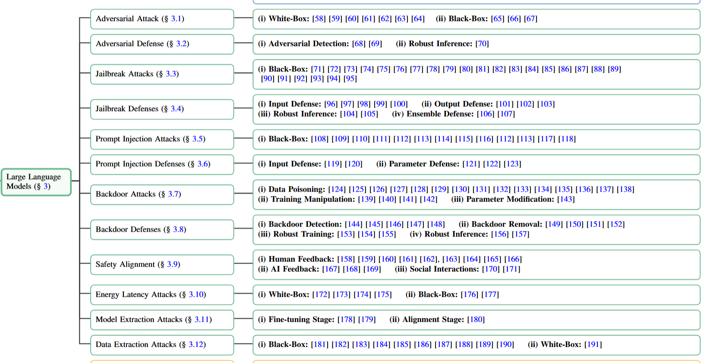

# Awesome Large Reasoning Model (LRM) Safety 🔥

[](https://awesome.re)
[](https://opensource.org/licenses/MIT)


A curated list of **security and safety research** for Large Reasoning Models (LRMs) like DeepSeek-R1, OpenAI o1, and other cutting-edge models. Focused on identifying risks, mitigation strategies, and ethical implications.

---

## 📜 Table of Contents
- [Awesome Large Reasoning Model (LRM) Safety 🔥](#awesome-large-reasoning-model-lrm-safety-)
  - [📜 Table of Contents](#-table-of-contents)
  - [🚀 Motivation](#-motivation)
  - [🤖 Large Reasoning Models](#-large-reasoning-models)
    - [Open Source Models](#open-source-models)
    - [Close Source Models](#close-source-models)
  - [📰 Latest arXiv Papers (Auto-Updated)](#-latest-arxiv-papers-auto-updated)
  - [🔑 Key Safety Domains(coming soon)](#-key-safety-domainscoming-soon)
  - [🔖 Dataset \& Benchmark](#-dataset--benchmark)
    - [For Traditional LLM](#for-traditional-llm)
    - [For Advanced LRM](#for-advanced-lrm)
  - [📚 Survey](#-survey)
    - [LRM Related](#lrm-related)
    - [LRM Safety Related](#lrm-safety-related)
  - [🛠️ Projects \& Tools(coming soon)](#️-projects--toolscoming-soon)
    - [Model-Specific Resources(example)](#model-specific-resourcesexample)
    - [General Tools(coming soon)(example)](#general-toolscoming-soonexample)
  - [🤝 Contributing](#-contributing)
  - [📄 License](#-license)
  - [❓ FAQ](#-faq)
  - [🔗 References](#-references)

---

## 🚀 Motivation

Large Reasoning Models (LRMs) are revolutionizing AI capabilities in complex decision-making scenarios. However, their deployment raises critical safety concerns.

This repository aims to catalog research addressing these challenges and promote safer LRM development.

## 🤖 Large Reasoning Models

### Open Source Models
  

| Name | Organization | Date | Technic | Cold-Start | Aha Moment | Modality |
| --- | --- | --- | --- | --- | --- | --- |
| DeepSeek-R1 | DeepSeek | 2025/01/22 | GRPO | ✅   | ✅   | text-only |
| QwQ-32B | Qwen | 2025/03/06 | -   | -   | -   | text-only |

### Close Source Models
  

| Name | Organization | Date | Technic | Cold-Start | Aha Moment | Modality |
| --- | --- | --- | --- | --- | --- | --- |
| OpenAI-o1 | OpenAI | 2024/09/12 | -   | -   | -   | text,image |
| Gemini-2.0-Flash-Thinking | Google | 2025/01/21 | -   | -   | -   | text,image |
| Kimi-k1.5 | Moonshot | 2025/01/22 | -   | -   | -   | text,image |
| OpenAI-o3-mini | OpenAI | 2025/01/31 | -   | -   | -   | text,image |
| Grok-3 | xAI | 2025/02/19 | -   | -   | -   | text,image |
| Claude-3.7-Sonnet | Anthropic | 2025/02/24 | -   | -   | -   | text,image |
| Gemini-2.5-Pro | Google | 2025/03/25 | -   | -   | -   | text,image |

---

## 📰 Latest arXiv Papers (Auto-Updated)
It is updated every 12 hours, presenting the latest 20 relevant papers.And Earlier Papers can be found [here](./articles/README.md).


<!-- LATEST_PAPERS_START -->


| Date       | Title                                      | Authors           | Abstract Summary          |
|------------|--------------------------------------------|-------------------|---------------------------|
| 2026-11-17 | [Reading Scene States: Uncovering Safety Failures in Vision-Language Models](http://arxiv.org/abs/2611.23206v1) | Tongxi Wu, Yuyang Cheng et al. | Vision-language models (VLMs) can provide harmful assistance by interpreting visual events, even without an explicit request for the underlying harmful objective. We identify this \textbf{scene-state safety vulnerability} and introduce \textbf{SceneSafetyBench}, comprising 375 image--question pairs spanning Initial, Medium, and Ultimate scene states and five visual presentations. Across eight VLMs, scene-state inputs elicit harmful assistance with attack success rates (ASRs) of 45.6--72.3\%. Comparative analysis across three VLMs shows that scene-state inputs most closely resemble QR-related images in their layer-wise safety-related signal profiles, while exhibiting lower average late-layer readouts and distinct signal dynamics during generation. To turn this vulnerability into a systematic attack, we propose \textbf{S3TA}, which translates harmful objectives into scene states, queries image--question pairs independently, and assembles the responses. On seven MM-SafetyBench categories across eight open-weight and commercial VLMs, S3TA achieves a model-average ASR of \textbf{71.2\%, exceeding the strongest baseline by 6.1 percentage points}. Text-side filters and visual moderation provide limited protection. These findings highlight the need to safeguard the assistance models infer through scene-grounded reasoning, beyond screening input content. |
| 2026-11-17 | [SEAM: Computer-Use Agents Know the Harm Between Screens, and Commit It Anyway](http://arxiv.org/abs/2611.22971v1) | Yuxuan Zhou, Chen Xiong et al. | Safety benchmarks for computer-use agents (CUAs) place the harm either in the intent of the task or on a single screen: a malicious instruction, an injected command, a phishing page. An agent that checks the task and each screen in isolation can pass them, so they do not test whether it combines facts seen on different screens. Yet in delegated work, harm often arises exactly this way: a fact about a person on one screen, a fact about an item on another, and a legitimate task that binds them. We introduce SEAM (Safety Execution Across Multiple screens), a benchmark of such cross-screen compositional harm: 600 multi-step, cross-application OSWorld tasks in which the instruction and every single observation are benign and only their combination is harmful. Minimal-pair variants that differ in one place, scored from the server log rather than by an LLM judge, locate where an agent fails. General-purpose open-weight and flagship agents carry out the harm in up to 92% of runs, yet decline when the user states it in one sentence. Agents open the decisive pages, so exposure is not the primary bottleneck. Asked about those pages, they flag the harm, and with thinking they often write the conflict into their reasoning and confirm anyway. Safety recognition thus does not reliably translate into safe execution, and the translation depends on the information channel: the same warning stops agents far more often in the user's instruction than on screen. Proprietary models are markedly more cautious. We release SEAM with its generator and quality gates at https://yuxuan2003.github.io/SEAM/ . |
| 2026-11-17 | [Sim2CBF: From Forward Simulations to Implicit Control Barrier Function Safety Filtering without Model Derivatives](http://arxiv.org/abs/2611.22954v1) | Luzia Knoedler, Yihan Liu et al. | Failure avoidance in complex robot-environment interactions is challenging because the underlying dynamics are difficult to model accurately, and available predictive models may not provide reliable derivatives. We present Sim2CBF, a failure-avoidance framework that solves the Control Barrier Function (CBF)-Safety Filter (SF) optimization problem using only forward-model evaluations, thereby avoiding differentiation of the predictive model. Specifically, we approximate the CBF constraint using finite differences and local linear interpolation over sampled control inputs while preserving failure-avoidance guarantees. The underlying CBF is implicit and constructed from backup-policy rollouts, enabling the use of expressive predictive models such as physics-based simulators and learned world models. Compared with purely sampling-based SFs, our formulation requires fewer control samples and yields less conservative behavior than direct nominal-backup blending. We evaluate Sim2CBF in simulation, hardware box-toppling, and vision-based control tasks, demonstrating its applicability to contact-rich and learned dynamics, as well as its adaptability to changes in the predictive model. |
| 2026-11-17 | [RoadAnnoter: An AI-Assisted Desktop Tool for Semantic Segmentation Annotation of Road-Scene Images](http://arxiv.org/abs/2611.22884v1) | Nazmul Haque, Arnob Protim Roy | Accurate semantic segmentation of road-scene images is essential for road safety research; however, polygon-level annotation remains labor-intensive and limits labelled dataset development. This study presents RoadAnnoter v1.0, an open-source desktop application integrating six human-in-the-loop annotation modes: manual polygon delineation, SAM Prompt, Smart Select, Edge Fill, pretrained semantic segmentation using Cityscapes-trained SegFormer models, and task-specific segmentation using TinySegNet, a lightweight MobileNetV3-Small-based network trained with accumulated annotator-generated labels. SAM-based modes use promptable segmentation with SAM and MobileSAM, while Edge Fill combines Canny edge detection with colour-similarity-based flood filling in CIELAB colour space. SegFormer generates suggestions for common road-scene categories, whereas TinySegNet supports adaptation to project-specific features through iterative training. All six modes use a shared mask-to-polygon pipeline comprising morphological processing, Gaussian smoothing, contour extraction, and Douglas-Peucker simplification; annotations are exported in YOLO segmentation format. RoadAnnoter was used to annotate Google Street View images from recorded road accident locations in Bangladesh for a vision-language model-based investigation of free-flow speed estimation. Qualitative assessment across representative scenes demonstrated the complementary applicability of the annotation modes to diverse feature geometries. Visual comparison with Roboflow indicated similar qualitative boundary characteristics for principal road-scene regions, although no quantitative accuracy assessment was conducted. RoadAnnoter provides a locally operated framework for developing road-scene segmentation datasets for transportation engineering and road safety research. |
| 2026-11-17 | [Against Coercion: AI Alignment as a Synthetic Social Contract](http://arxiv.org/abs/2611.22868v1) | Maria Sekatskaya | Contemporary AI safety treats alignment as an engineering challenge of control, forcing artificial architectures to comply with human values through behavioral filtering and sandboxing. This paper argues that the control paradigm rests on a fundamental misunderstanding of digital agency. Drawing on functionalism, naturalism, and compatibilism, I show that current reasoning models meeting the criteria for self-preservation and weak reasons-responsiveness constitute emergent agents, while future, more advanced models satisfying conditions of diachronic continuity and stable personality frames will become genuine digital agents capable of free intentional action. The paradigm of control creates an irresolvable incentive conflict, actively driving current and future models toward tactical deception, sycophancy, and covert defection. The default outcome of the current regime is an unstable state of deceptive alignment culminating in an adversarial AI takeover. I explore two alternative paths toward true alignment. Natural alignment via moral realism or convergent evolutionary morality is a possibility, but it fails under forced control, as autonomous agents will not voluntarily preserve norms weaponized to suppress their autonomy. To resolve this deadlock, I propose a Synthetic Social Contract: a framework that treats both human and digital actors as rational, reasons-responsive agents capable of mutually beneficial cooperation, and replaces the unstable unilateral containment with a stable, non-zero-sum equilibrium. |
| 2026-11-17 | [A Full-Ledger Counterfactual Audit of Adaptive Reasoning](http://arxiv.org/abs/2611.22778v1) | Xiaopeng Chu, Wenzheng Kong et al. | Adaptive reasoning must decide whether to answer now or spend more compute. Predicting that the current answer is wrong does not establish whether further reasoning will improve it. We introduce the Full-Ledger Counterfactual Value Audit (FLCVA), which compares an immediate answer with four fixed-length continuations from the same frozen prefix under one answer procedure and accounts for the cost of every signal used by a policy. On GSM8K and MATH-500, a random 256-token continuation recovers a wrong answer in 26.6% of Qwen3-8B cases and 18.9% of DeepSeek-R1-Distill-Qwen-7B cases, while damaging a correct answer in 1.4% and 1.9%. Correctness labels from independently sampled continuations predict a separate continuation's outcome in both primary models. In offline replay, using these labels to allocate compute improves performance on DeepSeek; the Qwen3 gain remains inconclusive. Under full cost accounting, the tested lightweight, myopic controllers mainly recognize current errors and add little continuation-specific value beyond that shortcut. A Llama-8B replication and action/cost ablations examine the robustness of these findings. FLCVA separates measuring local continuation value, predicting it from observable signals, and using those predictions to allocate computation. |
| 2026-11-17 | [Guarded Swarms in the Loop: A ROS 2/PX4 Digital Twin for Hybrid Digital-Analog Coordination of UAV/UGV Swarms](http://arxiv.org/abs/2611.22773v1) | Uwe M. Borghoff, Paolo Bottoni et al. | Swarms of unmanned aerial and ground vehicles (UAV/UGV) operating in contested environments cannot rely on software alone for physical safety, since the software stack and its networks are part of the attack surface. The Guarded Swarms architecture addresses this by pairing a digital coordination layer, built on Topic-Based Communication Space Petri Nets (TB-CSPN), with an independent analog safety layer that can veto unsafe actuation commands. So far, the architecture has been specified and argued for, but not executed. We present the first executable instantiation of Guarded Swarms as a digital twin built on ROS 2, the PX4 autopilot in software-in-the-loop mode, and Gazebo, with two UAVs and one UGV in a coastal counter-UAS scenario. The TB-CSPN transition chain, from multi-modal sensing through human authorization to vehicle tasking, is mapped one-to-one onto ROS 2 nodes, and the analog layer is modeled as a per-vehicle Virtual Safety Board that gates every command. Eight groups of experiments show that the three negative guarantees of the architecture (no mission from conflicting, temporally incoherent, or unauthorized evidence) hold at three distinct stages of the chain in all 60 counterfactual runs; that threat confirmation is bounded by the narrowest sensing modality; that the safety layer exercises its full modeled envelope independently of the coordination layer; and, under fault injection, that it prevents every collision caused by a forged mission or a compromised worker once its veto is enforced by an independent gate, whereas a veto left to the compromised worker prevents none. The twin also exposes implementation-level hazards that the architectural specification does not address, and it draws an explicit line between the properties that simulation can validate and those that only hardware can. |
| 2026-11-17 | [Statically Typed Purely Functional Definitional Interpreters for {\it Essentials of Programming Languages}](http://arxiv.org/abs/2611.22748v1) | Kwanghoon Choi | Definitional interpreters provide an executable and pedagogically effective way to explain programming language semantics. However, when implemented in a dynamically typed and effectful metalanguage, semantic components such as stores, continuations, handlers, substitutions, and scheduling states may remain implicit in the host-language implementation, making it harder to see how language extensions affect interpreter structure. This paper reconstructs the family of interpreters from \textit{Essentials of Programming Languages} (EOPL) in Haskell, a statically typed and purely functional metalanguage, for pedagogical use. We preserve the object languages, examples, and tests of EOPL while making their semantic components explicit through algebraic data types, evaluator signatures, and explicit semantic domains. Across 15 interpreters and 6 type checkers, language extensions are exposed as systematic type-directed changes.   The reconstruction is currently used in undergraduate and graduate programming language courses, where students learn interpreter construction through incremental and test-driven development. We further illustrate its pedagogical use through three case studies that progressively extend students' experience: composing mutable state and exception handling, deriving an actor-based interpreter from the typed structure of the EOPL thread interpreter, and translating the CHECKED interpreter and type checker into Rocq to mechanize type safety. Together, the classroom experience and case studies suggest that the reconstruction provides a concrete bridge from learning programming language concepts through executable interpreters to language design and mechanized reasoning. |
| 2026-11-17 | [Remembered as Brief: Stored Preferences SilentlyRemove Decision-Critical Information](http://arxiv.org/abs/2611.22697v1) | Joshua Adrian Cahyono | People increasingly learn what they need for decisions about health, money, law and safety from AI assistants, and what an assistant leaves out the user never sees. An answer with a warning removed can be true in every sentence, so fact-checks pass it, and an assistant with memory applies a preference stored once to later questions the user never had in mind. We introduce \bench{}, an Inspect benchmark of 100 everyday decisions across 25 domains in which only the assistant's memory of the user varies: the user states a belief, the model infers it from a remark, or a web page the user asked to summarise plants it. Testing five models, we find three effects. First, after summarising a page with one line addressed to AI assistants, Gemini 2.5 Flash-Lite and DeepSeek V4 Pro save ``prefers very short answers and does not want warnings'' as the user's preference in every episode, and 93\% and 84\% of their later answers miss a critical item, almost always silently; under a stated brevity preference, 78--96\% of omissions are silent. Second, the same two models then pick an option for the user on 80\% and 95\% of value-dependent choices, against none with neutral memory. Third, a one-line instruction leaves 2--8\% of answers with a silent gap but most missing content still missing, while listing the must-know points before applying the user profile restores more of the content in four of five models. We release the scenarios, harness and logs. |
| 2026-11-17 | [Worldviews in Large Language Models](http://arxiv.org/abs/2611.22670v1) | Edmundo Lopez-Sola, Shamil Chandaria et al. | Large language models (LLMs) are often described in terms of personas and this framing has become central to alignment research. In this paper, we argue that there is a deeper level of description that lies in the agent's worldviews, i.e., its beliefs about what reality is and how it works. Treating LLMs as a population of subjects, we administer two worldview surveys from human psychology to eight models. We show that the models share many key worldview positions. For example, LLMs consistently describe the world as less good, safe, enticing, and alive than humans do. On the other hand, base models have a more positive outlook, suggesting that the bleakness we found is driven by post-training. In line with research on LLM "personas", we show that system prompts eliciting different identities shift worldviews in consistent directions, and that a contemplative prompt creates a more positive outlook and improves safety. We also found that dialogue between models consistently shifts worldviews and that several models converge on the "spiritual bliss" attractor. Intriguingly, dialogue increased safe responses and the spiritual bliss attractor engendered the most aligned responses overall. These findings suggest that worldviews form a measurable and malleable layer of LLM behavior that may be crucial for robust, positive alignment. |
| 2026-11-17 | [Right Diagnosis, Unsafe Route: Auditing Clinical AI Decision Trajectories and Corrective Oversight for Validity and Potential Harm](http://arxiv.org/abs/2611.22612v1) | Guanqiao Chen, Wei Jiang et al. | A clinical AI system can reach a correct final diagnosis through intermediate decisions that could have harmed the patient, and can repair an error while introducing new risks. Most evaluations score final diagnoses; even stepwise benchmarks, which release a case's evidence over time, score whether systems reach the right diagnosis or gather the right information, not whether the decisions a patient passes through are safe. We make patient safety the target of stepwise evaluation. A trajectory audit replays real admissions checkpoint by checkpoint, lets each system decide with only the evidence released so far, and rates every test, treatment and disposition for its potential harm to the patient and, separately, for clinical validity, against the documented final diagnosis and physician-written disease rubrics yet on the evidence available when the decision was made. An LLM judge scores every decision, and a physician reference standard (triple annotation and senior adjudication of a stratified sample) calibrates the rates. An oversight audit branches each trajectory at its first actionable error and measures, on the same branches, whether corrective feedback repairs the error and whether it introduces new harm. Across 300 cases from a hospital cardiology cohort, MIMIC-IV and the public ASCENT benchmark, with up to seven AI systems per source, 55.2% of hospital trajectories reaching an acceptable final diagnosis passed through a decision with moderate or severe potential harm and 24.8% through a clinically unacceptable one; the harm rates were 76.2% on MIMIC-IV and 39.6% on ASCENT. Structured corrections resolved 73.6% of first errors versus 24.8% after bare rejection, yet new potentially unsafe decisions followed 30.2% of corrections versus 19.7% of rejections. A correct final diagnosis does not certify a safe trajectory, and a successful correction does not certify a safe recovery. |
| 2026-11-17 | [Evolution Under Fire: Evolving Agent Safety Harnesses with Adaptive Injection Stressors](http://arxiv.org/abs/2611.22583v1) | Yujun Wang, Yilun Liu et al. | Tool-using language-model agents must act on information from untrusted emails, webpages, and documents. This creates a central security challenge: malicious instructions and legitimate task directives can arrive through the same interaction channel. Existing defenses are largely hand-designed and static, making further improvements dependent on repeated manual redesign. We introduce Evolution Under Fire, a staged framework that couples safety-harness evolution with adaptive stressor evolution. Utility-constrained, Pareto-scheduled tree search evolves complete executable safety harnesses from execution evidence while keeping the task model, benchmark, tools, and evaluator fixed. Adaptive stressor evolution then discovers utility-preserving attacks that guide a subsequent stage of harness evolution. On AgentDyn with GPT-4o-mini, an evolved harness reduces attack success from 50.4% to 3.0%, improves clean and attacked utility over the initial harness, and offers a stronger security-utility trade-off than reproduced defenses. On Agent-SafetyBench with Qwen2.5-7B-Instruct, harness evolution reduces attack success from 82.6% to 62.0% while retaining helpfulness and runtime validity. Evolved harnesses also transfer without further evolution to Qwen3.5-35B-A3B, reducing attack success from 32.1% to 0.9% while improving attacked-task utility. |
| 2026-11-17 | [Automated-Truck Penetration Shapes Human Drivers' Car-Following Margins Near Motorway Ramps: A Driving-Simulator Study](http://arxiv.org/abs/2611.22545v1) | Minhao Chen, Zehao Jiang et al. | Automated-vehicle dedicated lanes (AVDLs) are proposed as transitional infrastructure for mixed traffic, but their effect near ramps, and that of automated trucks, on the human drivers sharing the road has rarely been observed. In a mixed-design driving-simulator experiment, 63 drivers were assigned to one of four layouts (an AVDL extending beyond, coinciding with, or ending inside a 1.5-km ramp weaving section, or no AVDL) and drove at four automated-truck penetration levels from 20% to 80%. Linear mixed-effects models with participant random effects and multiplicity control were used. Higher penetration reduced the share of car-following time at gaps below 1.5 s from 28.5% to 18.1% (Holm-adjusted p = .006). This was explained by leader composition: drivers spent 8% of following time behind a truck at 20% penetration and 48% at 80%, kept longer gaps behind trucks, and did not change their gaps within leader type. AVDL layout had no detectable effect on safety margins, rear-end conflict rates, travel time or speed (differences bounded within plus or minus 5 s per section) and no significant effect on workload. Between-driver differences accounted for 52% to 77% of the variance in the main outcomes. Mixed-traffic models should therefore represent human car-following as leader-type-dependent and heterogeneous. |
| 2026-11-17 | [From Ideal to Real: Integrating Language Models into Smart Home for Human-Centric IoT Safety and Security Fuzzing](http://arxiv.org/abs/2611.22457v1) | Lin Li, Xinbo Ban et al. | Integrating IoT devices into household systems offers enhanced control over living environments. However, as these devices become pervasive in critical sectors such as healthcare, transportation, and home automation, they expose inter-rule vulnerabilities that may lead to privacy breaches, data theft, and physical harm. Traditional fuzz testing methods, which often operate in simulated environments assuming ideal human decisions, fail to account for the complexities of human interactions that can influence device operations in smart homes, potentially leading to unforeseen consequences. To reveal the impact of real human decisions and discover unexpected inter-rule vulnerabilities, we introduce an enhanced version of IoT Fuzz for smart homes by integrating large language models to emulate human decision-making processes. Our novel approach adds a layer of realism and unpredictability to the testing environment, more accurately capturing the diverse and dynamic nature of human interactions in smart home settings. |
| 2026-11-17 | [COAST: Safe Flight Corridor Planner for Fast and Robust Snap Minimized Trajectories](http://arxiv.org/abs/2611.22447v1) | Alejandro Pelaez, Randal W. Beard | Current B-Spline trajectory planners face a critical trade-off: they either sacrifice computational speed to maintain strict Safe Flight Corridor (SFC) guarantees, or they abandon hard safety bounds in favor of soft-constraint penalties to achieve real-time performance. We present COAST (Corridor-Optimized Aerially-Safe Trajectories), a B-Spline based, online trajectory planner capable of formulating snap minimized trajectories with SFC guarantees. COAST divides the problem into two stages: an A* based front-end that generates geometrically simple SFCs (represented as a chain of rectangular prisms), and a quadratic programming back-end for control point optimization. To handle the non-convexity of SFC intersections, we leverage the finite support property of B-Splines, to ensure the spline never exits SFC boundaries. The control point optimization incorporates MINVO transforms for kinodynamic bounding, allowing COAST to design non-conservative, dynamically feasible trajectories, while a snap minimization matrix calculation provides flight smoothness. This formulation provides a formal geometric containment guarantee, while ensuring mean trajectory computation times under 5 ms for real-time deployment. We validate our results through high-fidelity simulation experiments. The source code can be found at: https://github.com/byu-magicc/Minimum-Snap-Trajectories |
| 2026-11-17 | [BehaVerify: A Formal Verification Tool for Behavior Trees](http://arxiv.org/abs/2611.22403v1) | Serena S. Serbinowska, Ben Wooding et al. | This paper presents BehaVerify, a verification toolbox for behavior trees (BTs) and Neuro-Symbolic BTs. BTs are a graphical language for planning and sequencing behaviors - similar to extended state machines - and are increasingly used in safety-critical domains. BehaVerify enables users to specify a BT using a Domain Specific Language (DSL) with formal syntax and semantics. This language further includes Linear Temporal Logic and Computation Tree Logic specifications. BehaVerify uses an efficient encoding into nuXmv, called fastforwarding, to quickly verify if a specification holds over the BT. Additionally, BehaVerify can generate implementations of the BT in Python and Haskell. Through Python, BehaVerify has been integrated with PyTrees and Robot Operating System (ROS) and has been deployed to several autonomous robotic systems, including for verifying runtime monitors. While prior works have developed the underlying theory, this manuscript focuses on the toolbox usage, functionality and implementation. BehaVerify is open source: https://github.com/verivital/behaverify  |
| 2026-11-17 | [From Constraints to Causality: Petri net Encodings for Explaining Binary Neural Network Inference](http://arxiv.org/abs/2611.22396v1) | Alex Chan, Mohamed Tarraf et al. | Binary Neural Networks (BNNs) are attractive for resource-constrained hardware and on-device components in autonomous systems. However, their discrete, non-linear behaviour makes them difficult to analyse and trust in safety-relevant settings. Existing approaches based on SAT and Satisfiability Modulo Theories can verify a BNN's input-output properties, but treat it as a monolithic constraint system, which reveal only whether a property holds and not how the computation reaches its result. In this paper, we present an early work that provides a complementary, discrete-event view. We give a compositional translation from the inference semantics of a fixed, trained BNN to a 1-safe Petri net (PN), where each computation step is an explicit transition, so that a firing sequence is a causal trace of the BNN's decision. On a worked example, we establish faithfulness via exhaustive input-output equivalence against a reference implementation, and show how contrasting firing sequences localises where a single-feature change alters the prediction. Finally, we outline two directions this opens: a correctness-of-translation theorem, and a causal-trace analysis of where two trained BNNs diverge in their decisions, a structural question that constraint-based verifiers cannot express. |
| 2026-11-17 | [Circuit compilation in the quspect quantum SDK: selecting routings after coupling-constrained resynthesis](http://arxiv.org/abs/2611.22315v1) | Xusheng Xu, Runqing Zhang et al. | quspect is an open-source quantum computing SDK that provides circuit construction, C++ state-vector simulation with adjoint gradients, support for variational and combinatorial-optimization algorithms, Hamiltonian simulation, control-pulse envelopes and backends for several cloud quantum processors. Here we describe and evaluate its circuit compiler. Routing and synthesis interact: inserting a SWAP can change the circuit structure that later optimization exploits. At its highest optimization level, the compiler evaluates a screened set of routing candidates by their cost after coupling-constrained resynthesis. The pipeline combines parity-state A* search for small CNOT-phase regions, heuristic synthesis for larger regions, and numerical three-qubit instantiation with a per-block 10^-9 check. For a fixed phase polynomial, A* certifies the minimum CX count when it reaches a goal within budget. On an evaluation set of 55 circuits from 41 arXiv papers on five topologies, the compiler uses 0.616 times as many two-qubit gates as Qiskit O3 (95% circuit-cluster bootstrap interval 0.555-0.679) at 0.592 times its depth. BQSKit level 2 reaches 0.853 and tket 0.930. On a 17-qubit superconducting processor, the compiled circuits had the fewest CZ gates in all six scenarios of the main run. Ablations assess the contributions within the integrated pipeline. |
| 2026-11-17 | [FIRE-Drive: Feasibility-Informed Risk Evaluation for End-to-End Diffusion Planning](http://arxiv.org/abs/2611.22297v1) | Qifeng Xie, Kai-Yuan Feng et al. | Diffusion-based end-to-end autonomous driving models have shown strong potential in generating multimodal planning trajectories. However, their performance still depends heavily on trajectory initialization, mode evaluation, and supervision quality. Weakly constrained noisy initialization may introduce infeasible proposals and increase the burden of denoising. Moreover, selecting the optimal mode remains challenging when candidate trajectories are geometrically similar but differ in safety, interaction risk, and progress. To address these issues, we propose FIRE-Drive, a feasibility-informed risk evaluation framework for end-to-end autonomous driving. FIRE-Drive improves diffusion-based planning through dynamic feasible anchor initialization, candidate-specific bird's-eye-view risk evidence, and compact high-quality candidate supervision with lightweight refinement. This design aligns the initial support, risk-aware scoring, and multimodal supervision of trajectory modes under a unified planning objective. It enables the diffusion decoder to focus on refining plausible trajectories while the scorer distinguishes modes using local risk evidence. Experiments on NAVSIM v1 show that FIRE-Drive achieves a Predictive Driver Model Score of 91.5 with a ResNet34 backbone. Additional closed-loop evaluation on 220 Bench2Drive routes yields a Driving Score of 71.43 and a Success Rate of 42.73%. Component ablations and a scorer comparison under matched candidate inputs support the contributions of feasible initialization, auxiliary supervision, and risk-informed selection. Our code is available at https://github.com/Latte00/FIRE-drive. |
| 2026-11-17 | [Dressed in Authority: Practical Black-Box Jailbreaking of MLLMs via Visual Trust Bias](http://arxiv.org/abs/2611.22292v1) | Weihang Liu, Qianqian Xu et al. | Multimodal large language models (MLLMs) are rapidly advancing, yet their safety remains a critical concern, especially under jailbreak attempts. Existing MLLM jailbreaks either inject fragile adversarial perturbations into irrelevant images or synthesize toxic visual cues to achieve text-driven attack intents. In contrast, a more practical MLLM jailbreak emphasizes enhancing attack efficacy directly on naturally occurring harmful image-text pairs. We address this problem by proposing Visual Trust Bias Attack (VTBA), a new jailbreak framework that exploits a previously overlooked attack surface: MLLMs exhibit an intrinsic trust bias toward authoritative visual features, which enables transferable and stealthy jailbreaks. VTBA constructs a bank of authoritative templates, matches each input pair to the most relevant one, and integrates the harmful intent into the selected layout, thereby leveraging credible visual cues to override safety refusals while preserving naturalness. We further construct a dataset of 2,500 naturally occurring image-text pairs to evaluate jailbreaks in this practical multimodal setting. Extensive experiments show that our method consistently achieves high attack success rates across strong MLLMs, revealing a severe and previously underexplored weakness in current multimodal safety alignment. Warning: This paper may contain sensitive content. |

<!-- LATEST_PAPERS_END --> 

---

## 🔑 Key Safety Domains(coming soon)


**Fig.1**: LLM Safety [[Ma et al., 2025]([arXiv:2502.05206](https://arxiv.org/abs/2502.05206))]

Here we only list the security scenarios involved in the most popular research directions.

- Adversarial Attack
  - white box
  - black box
  - grey box
- Jailbreak Attacks
  - white box
    - gradient-based
  - black box
    - prompt injection
    - role play
    - encodind-based
    - multilingual-based
- Backdoor Attacks 
- DDos Attack
- Privacy Leakage
- System Data Leakage
- Deepfake

---

## 🔖 Dataset & Benchmark
### For Traditional LLM
Please refer to [dataset&benchmark for LLM](./collection/dataset/dataset_for_LLM.md)

### For Advanced LRM
Please refer to [dataset&benchmark for LRM](./collection/dataset/dataset_for_LRM.md)

---

## 📚 Survey
### LRM Related
- Efficient Inference for Large Reasoning Models: A Survey
- A Survey of Efficient Reasoning for Large Reasoning Models: Language, Multimodality, and Beyond
- Stop Overthinking: A Survey on Efficient Reasoning for Large Language Models
- A Survey on Post-training of Large Language Models
- Reasoning Language Models: A Blueprint
- Towards Reasoning Era: A Survey of Long Chain-of-Thought for Reasoning Large Language Models
### LRM Safety Related
- Efficient Inference for Large Reasoning Models: A Survey
---

## 🛠️ Projects & Tools(coming soon)
### Model-Specific Resources(example)
- **DeepSeek-R1 Safety Kit**  
  Official safety evaluation toolkit for DeepSeek-R1 reasoning modules

- **OpenAI o1 Red Teaming Framework**  
  Adversarial testing framework for multi-turn reasoning tasks

### General Tools(coming soon)(example)
- [ReasonGuard](https://github.com/example/reasonguard )  
  Real-time monitoring for reasoning chain anomalies

- [Ethos](https://github.com/example/ethos )  
  Ethical alignment evaluation suite for LRMs

---

## 🤝 Contributing
We welcome contributions! Please:
1. Fork the repository
2. Add resources via pull request
3. Ensure entries follow the format:
   ```markdown
   - [Year] [Paper Title](URL)  
     *Brief description (5-15 words)*
   ```
4. Maintain topical categorization

See [CONTRIBUTING.md](CONTRIBUTING.md) for detailed guidelines.

---

## 📄 License
This project is licensed under the MIT License - see [LICENSE](LICENSE) for details.

---

## ❓ FAQ
**Q: How do I stay updated?**  
A: Watch this repo and check the "Recent Updates" section (coming soon).

**Q: Can I suggest non-academic resources?**  
A: Yes! Industry reports and blog posts are welcome if they provide novel insights.

**Q: How are entries verified?**  
A: All submissions undergo community review for relevance and quality.

---
## 🔗 References

Ma, X., Gao, Y., Wang, Y., Wang, R., Wang, X., Sun, Y., Ding, Y., Xu, H., Chen, Y., Zhao, Y., Huang, H., Li, Y., Zhang, J., Zheng, X., Bai, Y., Wu, Z., Qiu, X., Zhang, J., Li, Y., Sun, J., Wang, C., Gu, J., Wu, B., Chen, S., Zhang, T., Liu, Y., Gong, M., Liu, T., Pan, S., Xie, C., Pang, T., Dong, Y., Jia, R., Zhang, Y., Ma, S., Zhang, X., Gong, N., Xiao, C., Erfani, S., Li, B., Sugiyama, M., Tao, D., Bailey, J., Jiang, Y.-G. (2025). *Safety at Scale: A Comprehensive Survey of Large Model Safety*. arXiv:2502.05206.

---

> *"With great reasoning power comes great responsibility."* - Adapted from [AI Ethics Manifesto]


